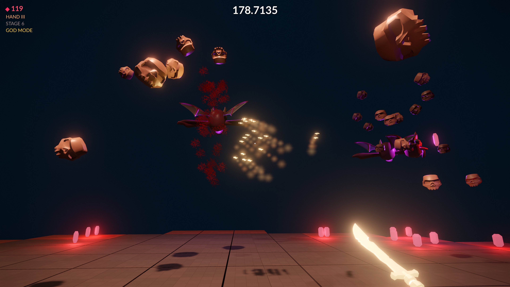

# Demon's Cove

*Demon's Cove* is a small arena shooter game made with [ezEngine](https://ezengine.net).

Survive as long as possible on a floating platform. Daggers kill the enemies, enemies drop gems, gems upgrade your hand.

This game was made as a test to see how well AI agents can leverage the engine using EZ's MCP server. The task for the agent was to take a few provided assets and build the game from the ground up, ie setting up the project from scratch, importing the assets, building the game plugin and iterating on the game functionality until it works. It proves that ezEngine is very well suited to be used with and by AI agents.

Nevertheless, it relied on an existing, well defined game idea, namely [Devil Daggers](https://store.steampowered.com/app/422970/Devil_Daggers) by Sorath, that it could replicate. If you enjoy playing this clone, I'd recommend to buy the original.

## Prebuilt Binaries

Download prebuilt binaries from the [Releases](https://github.com/jankrassnigg/demons-cove/releases), unpack the archive and launch the game with the `.bat` file.

## Building and Running the game

Demon's Cove needs a recent ezEngine build from the `dev` branch.

1. Open this folder as a project in ezEditor. The editor offers to compile the C++ plugin in `CppSource`; let it do that.
2. Open `Scenes/Main.ezScene` and play it (*Play the Game*, Ctrl+F5).

To run it without the editor, export the project (*Project > Export Project*) and use the `.bat` file in the export folder to launch the game.

## Controls

| Keyboard and mouse | Gamepad | Action |
| --- | --- | --- |
| WASD / mouse | Left stick / right stick | Move and look |
| Space | A or left shoulder | Jump |
| Left mouse click | Right trigger or right shoulder, tap | Shotgun burst |
| Left mouse hold | Right trigger or right shoulder, hold | Dagger stream |
| R | Y | Restart the round |
| ESC | Start | Menu (resume, settings, exit) |

The first round starts when you pick up the dagger floating in front of you.

## Enemies

| Enemy | Behavior |
| --- | --- |
| Squid I / II | Hover around the arena and release skull swarms. They only take damage at their glowing gems (one, or two for Squid II); the body blocks daggers. |
| Skull I | Swarm enemy, homes in on you. |
| Skull II | Circles you and dashes at you. |
| Skeleton | Groups that climb onto the platform and run at you. |
| Thief | Crawls over the floor and collects gems lying around. Kill it to get them back. |
| Centipede | Flies through the arena with a long body. Segments can be shot off, killing the head kills the whole body. |

Hand levels: level 2 at 10 gems (faster stream, bigger shotgun), level 3 at 50 gems (homing daggers).

During the endless phase (stage 6) the arena crumbles at the edge. Tiles turn red shortly before they fall.

The 10 best rounds are kept in a scoreboard in the user's app data folder (`ezPlayer/DemonCove/Scores.txt`, one `time kills gems` line per round). The death screen shows it and highlights the place of the round just played. Rounds with any of the debug CVars below don't count.

## Debug CVars

All of these can be set on the command line, for example `-DemonCove.GodMode 1 -DemonCove.StartStage 5`.

| CVar | Effect |
| --- | --- |
| `DemonCove.GodMode` | Enemies can't kill you (they disappear on contact), and a wall around the arena prevents falling off. Falling into a crumbled hole respawns you. |
| `DemonCove.StartStage` | Stage a new round starts at (1-6, 6 is the endless phase). |
| `DemonCove.StartGems` | Gems at the start of a round, which determines the hand level. |
| `DemonCove.DebugAutoAim` | Daggers fly towards the closest enemy (or its gem) and the view turns towards it. For automated tests. |
| `DemonCove.DebugSpawn` | Set to an enemy type index to spawn one: 0 Squid I, 1 Squid II, 5 Thief, 6 Centipede. Resets itself. |
| `DemonCove.DebugStress` | Set to 1 to spawn the worst case number of enemies and gems at once, for performance measurements. |
| `DemonCove.ShowStats` | Shows dagger, kill and per-enemy-type statistics. |
| `DemonCove.GemAttractRange` | Distance at which gems fly towards you. |

## Code

The game logic is in the C++ plugin in `CppSource/DemonCovePlugin`:

| Folder | Contents |
| --- | --- |
| `Arena` | `DcArenaComponent` runs the game rules: spawn timeline, enemies, daggers, gems, player death and restart. Enemies, daggers and gems are plain data, their game objects (prefab instances) are only visuals. Collision checks are sphere tests. The implementation is split into `DcArenaComponent.cpp` (round flow), `DcArenaEnemies.cpp` and `DcArenaDaggersAndGems.cpp`. `DcEnemyType` is a table with the stats of each enemy type. `DcArenaFloorComponent` builds the tile floor that crumbles during the endless phase. `DcScoreboard` loads and saves the best rounds. |
| `Audio` | `DcAudioComponent` holds all sound and music assets. Gameplay code only says what happened (`DcSound::GemPickup`), so all audio can be configured in one place. |
| `Player` | `DcPlayerComponent` handles input, movement through the Jolt character controller, and firing. |
| `UI` | `DcHudComponent` fills the blackboard that the HUD document is bound to. |
| `GameState` | `DemonCoveGameState` picks the startup scene, shows the loading screen and opens the RmlUi main menu on ESC. |
| `Common` | Console variables and small helpers. |

In the scene, the `Arena` object holds the arena, floor and audio components. The grey box next to them only shows the arena's shape in the editor and is hidden when the game runs.

The player prefab (`Prefabs/Player/Player.ezPrefab`) is spawned by the game state at the player start. It also contains the HUD: an RmlUi canvas showing `UI/Hud.rml`, with a `DcHudComponent` that provides the `hud` blackboard the document binds to. That way the HUD only shows up when the game is played, not while editing the level. The main menu is part of the scene.

Input actions are configured in `RuntimeConfigs/InputConfig.ddl` (*Project > Input Configuration* in the editor).

## Credits

- Game idea: [Devil Daggers](https://store.steampowered.com/app/422970/Devil_Daggers/) by Sorath.
- 3D models: [Quaternius](https://quaternius.com) (CC0).
- Sounds and music: various authors on [Freesound](https://freesound.org), under CC0, CC BY and Sampling+ licenses.

[Credits.md](Credits.md) lists every model pack and every sound with its author and license.
